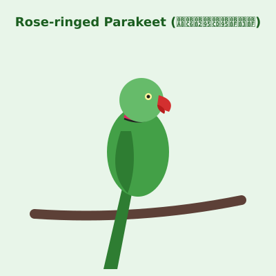

# Madras Field Notes 🌿🐦

**சென்னை களக் குறிப்புகள்** — A fully offline, installable PWA that helps you identify and learn about birds and plants around IIT Madras campus and Chennai wetlands. Works in English and Tamil. Zero network dependency after first load.

## Demo



## Features

| Feature | Description |
|---------|-------------|
| **🔍 Identify** | Camera capture or gallery upload → CLIP zero-shot classification → top-3 species with confidence bars |
| **📚 Species Card** | Detailed card per species with facts, safety notes, and identifying features — switchable EN/தமிழ் |
| **💬 Ask AI** | Chat about a species. On desktop: local LLM (Qwen2.5-0.5B). On mobile: instant field-notes answers |
| **📓 Field Log** | Every identification auto-saved to local storage. Export as JSON. |
| **📱 Installable** | Add to home screen, works offline after first load |
| **⚡ Offline Ready** | Service worker precaches app shell + models. Full airplane-mode support |

## Species Covered (15)

**Birds:** Common Myna, Rose-ringed Parakeet, Spotted Dove, House Crow, White-throated Kingfisher, Asian Koel

**Plants:** Neem, Peepal (Sacred Fig), Banyan, Palash (Flame of the Forest), Hibiscus, Jasmine, Banana, Coconut Palm, Bougainvillea

## Tech Stack

- **Vite + TypeScript** — plain, no heavy UI framework
- **@huggingface/transformers v3** — CLIP for vision, Qwen2.5-0.5B for chat
- **VitePWA** — service worker, manifest, offline caching
- **Web Workers** — all inference off the main thread
- **Cache API** — model files cached for offline use

## Getting Started

### Prerequisites

- Node.js 18+
- Modern browser (Chrome/Edge recommended)

### Install & Run

```bash
# Clone
git clone https://github.com/pkbhalla/MadrasFieldNotes.git
cd MadrasFieldNotes

# Install dependencies
npm install

# Start dev server
npm run dev

# Build for production
npm run build

# Preview production build
npm run preview
```

### Deploy to Render (Static Site)

1. Push to GitHub
2. Create a new Static Site on [Render](https://render.com)
3. Set build command: `npm run build`
4. Set publish directory: `dist`
5. Deploy

## How It Works

### Identification Pipeline

```
Camera/Gallery → Resize (224×224) → CLIP zero-shot-image-classification
  → candidate labels built from species' identifyingFeatures
  → top-3 species with confidence scores
  → auto-save to Field Log
```

Confidence threshold: **0.35** — below this, shows "Not sure — closest guesses"

### AI Chat (Desktop)

```
User question → System prompt (selected species JSON) → Qwen2.5-0.5B-Instruct (WASM, q4)
  → Answer constrained to field notes data
  → Declines edibility/medical questions
  → Max 96 tokens, English only
```

### AI Chat (Mobile)

```
User question → Keyword matching → Answer from species facts/safety notes
  → Instant response, no download, no crash
```

### Capability Detection

| Condition | Mode |
|-----------|------|
| WebGPU + 4GB+ RAM | Full (CLIP + LLM) |
| WebGPU + 2-4GB RAM | Full (CLIP + LLM) |
| No WebGPU / low memory | Identification-only (CLIP WASM) |
| Mobile device | Identification + Field Notes chat |

## Project Structure

```
madras-field-notes/
├── public/
│   ├── pack/species.json          # 15 species knowledge pack
│   ├── samples/                   # Sample images for testing
│   └── icons/                     # PWA icons
├── src/
│   ├── workers/
│   │   ├── vision.worker.ts       # CLIP zero-shot classification
│   │   └── llm.worker.ts          # Qwen2.5 text generation
│   ├── lib/
│   │   ├── capabilities.ts        # Device detection
│   │   ├── cache-manager.ts       # Cache API management
│   │   ├── pack-loader.ts         # Species data loader
│   │   ├── prompts.ts             # System prompt builder
│   │   └── protocol.ts            # Worker message types
│   ├── screens/
│   │   ├── IdentifyScreen.ts      # Camera + classification logic
│   │   ├── SpeciesCard.ts         # Species detail rendering
│   │   ├── AskScreen.ts           # Chat screen
│   │   ├── FieldLog.ts            # Sighting storage
│   │   └── CapabilityScreen.ts    # Device capability check
│   ├── ui/
│   │   ├── App.ts                 # Main app class + router
│   │   └── styles.css             # Mobile-first CSS
│   └── main.ts                    # Entry point
├── scripts/
│   ├── make-icons.mts             # PWA icon generator
│   ├── test-app-logic.mts         # Logic tests
│   └── validate-pack.mjs          # Species pack validator
├── vite.config.ts                 # Vite + PWA config
├── tsconfig.json                  # TypeScript config
└── index.html                     # App shell
```

## Models Used

| Model | Size | Device | Purpose |
|-------|------|--------|---------|
| `Xenova/clip-vit-base-patch32` | ~150 MB | WASM | Image classification |
| `onnx-community/Qwen2.5-0.5B-Instruct` | ~350 MB | WASM (desktop) | Text generation |
| `onnx-community/SmolLM2-360M-Instruct` | ~220 MB | WASM (fallback) | Text generation |

Total model budget: **< 500 MB** (full mode), **< 150 MB** (identification-only)

## Mobile Performance

On mobile devices, the LLM is **disabled by default** to prevent out-of-memory crashes. The Ask feature uses instant field-notes answers instead. This keeps the app responsive on devices with 2-4 GB RAM.

To use the LLM on a capable tablet, the app will load it if the screen is ≥ 768px and `deviceMemory` ≥ 4GB.

## Browser Support

| Browser | Status |
|---------|--------|
| Chrome Android 90+ | ✅ Fully supported |
| Chrome Desktop 90+ | ✅ Fully supported |
| Edge 90+ | ✅ Fully supported |
| Firefox 90+ | ⚠️ WebGPU not available (WASM fallback) |
| Safari 16+ | ⚠️ Limited WebGPU support |

## Offline Behavior

1. **First load (online)**: App shell + species pack + CLIP model cached
2. **Subsequent loads (offline)**: Everything from cache, zero network requests
3. **Storage eviction**: `navigator.storage.persist()` called on first load. If cache is evicted, models re-download on next online session.

## License

MIT License. See [LICENSE](LICENSE) for details.

## Acknowledgements

- [Hugging Face Transformers.js](https://huggingface.co/docs/transformers.js) — browser-based inference
- [Vite PWA Plugin](https://vite-pwa-org.netlify.app/) — service worker generation
- [Xenova](https://huggingface.co/Xenova) — optimized ONNX models
- IIT Madras campus biodiversity — species data inspiration

## Author

**Pratham Bhalla** — [GitHub](https://github.com/pkbhalla)
